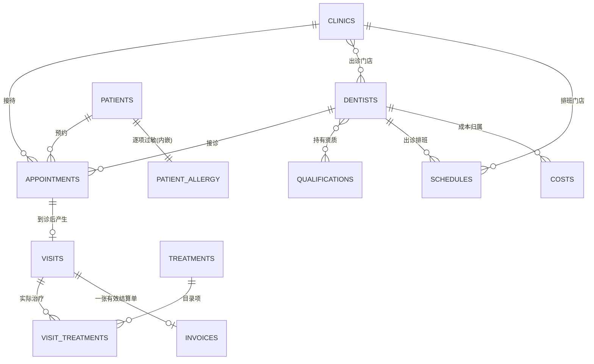

# 数据模型说明

对应《ADC 拟开发项目与业务需求说明》第 5 章。核心业务集合 11 个，后面做员工端时又加了 5 个支撑集合，实际落库 16 个。

---

## 一、为什么核心是 11 个集合

需求文档里能数出 14 类实体，合并成 11 个集合的理由只有一条：**一个集合 = 一个生命周期一致的业务对象**。

| 合并了什么 | 原因 |
|---|---|
| 过敏 → 患者文档里的数组 | 过敏永远跟着患者走，没有独立生命周期；但**每条独立存、带确认状态**，不能压成一个文本字段 |
| 结算单行 → 结算单文档里的 `lines` 数组 | 行不允许脱离单据单独存在；行里保留 `line_id` 指回治疗行，保证可追溯 |
| 资质 → 目录集合 + 牙医的 `qualification_ids` | 这是案例明确要求的多对多（一人多证、一证多人） |

没有合并的：`visits` 与 `appointments` 必须分开。预约是**计划**，就诊是**事实**；一个预约最多产生一个就诊，但取消的预约不产生就诊。混在一起就没法算取消率。

---

## 二、集合清单

### 1. `clinics` 诊所

| 字段 | 类型 | 说明 | 来源 |
|---|---|---|---|
| code / name | string | 门店编码、名称 | 拟议 |
| address | string | 邮政地址 | 案例第 1 页 |
| manager | string | 主管姓名 | 案例第 1 页 |
| phone / email | string | 电话、邮箱 | 案例第 1 页 |
| area | number | 办公面积（㎡） | 案例第 1 页 |
| active | bool | 是否营业 | 拟议 |

### 2. `qualifications` 资质目录

| 字段 | 说明 |
|---|---|
| code | 如 `Q-ENDO` |
| name | 牙髓病学 / 口腔病理学 / 口腔放射学 / 儿童牙科 / 口腔种植 |

### 3. `dentists` 牙医

| 字段 | 类型 | 说明 |
|---|---|---|
| emp_no | string | 员工编号，唯一 |
| name / dob / address / phone / email | — | 案例要求的个人资料 |
| `qualification_ids` | string[] | **多对多**：一人多证 |
| `qual_names` | string[] | 冗余名称，用于列表直接展示（避免每次联查） |
| `clinic_ids` | string[] | 出诊门店。**牙医不隶属单店**，跨店轮转是案例的硬要求 |
| active | bool | 离职后停用，但历史治疗与绩效保留 |

> 注意：这里**故意没有** `home_clinic_id`。一旦给牙医挂一个「所属门店」，跨店轮转就没法表达了，这是案例里最容易被做错的一点。

### 4. `patients` 患者

| 字段 | 类型 | 约束 |
|---|---|---|
| name / phone / dob | string | 三者组合用于核对身份，**不按手机号硬合并** |
| billing_address | string | 账单地址 |
| email | string | **可以为空**（T01） |
| emergency_name / emergency_phone | string | 紧急联系人 |
| `allergies` | array | `[{ name, confirmed }]`，逐项保存 |
| `allergy_inquiry_status` | enum | `NOT_ASKED` / `NO_KNOWN` / `REPORTED`，整份档案的询问状态 |
| created_at | number | |

过敏这件事要分两层看。每一条上的 `confirmed` 是「这一条牙医核实过没有」；整份档案的 `allergy_inquiry_status` 是「到底问过没有」。少了后一层，「还没问」和「问过、没有已知过敏」在界面上长得一模一样，牙医会误判。

### 5. `appointments` 预约

| 字段 | 类型 | 说明 |
|---|---|---|
| patient_id / patient_name / patient_phone | — | 冗余姓名电话，前台看板不联查 |
| clinic_id / clinic_name | — | 到哪家店 |
| dentist_id / dentist_name | — | 谁接诊 |
| date / start / end | string | `2026-11-24` / `09:00` / `09:30` |
| **slot_key** | string | 牙医、日期、起始时间三段拼成，**唯一索引建在这个字段上** |
| need | string | 患者电话里说的治疗需求，**不计费** |
| special_need | string | 本次特殊需求 |
| `attended` | bool | 案例要求的布尔字段，初值 `false` |
| status | enum | 见下方状态机 |
| rescheduled_from / rescheduled_to | id | 改约链，**原记录不删** |
| source | enum | `MINI` 患者自助 / `DESK` 前台电话 |

### 6. `visits` 就诊

| 字段 | 说明 |
|---|---|
| visit_no | 就诊号，`V20261124-001`，唯一 |
| appointment_id | 一对一 |
| patient_id / clinic_id / dentist_id | 事实归属 |
| special_need | 到诊时确认的特殊需求 |
| status | `OPEN` 诊疗中 / `DONE` 已签署 / `INVOICED` 已开单 |
| arrived_at | 实际到诊时间，独立于预约时间 |

### 7. `treatments` 治疗项目目录

| 字段 | 说明 |
|---|---|
| code / name | 如 `T-CLEAN` / 洗牙 |
| unit_price | **现价**，只用于新行取值 |
| standard_unit | 次 / 颗 / 疗程 |
| `required_qual_ids` | 做这个项目需要的资质（数组），预约时按它筛牙医 |
| `qual_match_mode` | `ANY` 任一 / `ALL` 全部，决定上面那组资质怎么匹配 |

### 8. `visit_treatments` 实际治疗行

| 字段 | 说明 |
|---|---|
| visit_id | 属于哪次就诊 |
| treatment_id | 指向目录 |
| **name** | **名称快照** —— 目录改名不影响历史 |
| units | 标准单位数 |
| **unit_price** | **单价快照** —— 目录调价不影响历史（T06） |
| subtotal | = units × unit_price |
| dentist_id | 执行牙医，绩效按这一行归属 |
| status | `DRAFT` 草稿 / `CONFIRMED` 已签署 |

### 9. `invoices` 结算单

| 字段 | 说明 |
|---|---|
| invoice_no | `I20261124-001`，唯一 |
| visit_id | **一次就诊一张有效单** |
| dentist_id | 收入归接到接诊牙医 |
| biz_date / period | 业务日期 / `2026Q4`，季度核算按 period 聚合 |
| `lines` | `[{ line_id, treatment_id, name, units, unit_price, subtotal }]` |
| total | 有效行小计之和 |
| version | 更正时递增，旧版本置为失效 |
| status | `VALID` / `SUPERSEDED` |

### 10. `costs` 成本与运营费用

| 字段 | 说明 |
|---|---|
| dentist_id | 归属牙医 |
| type | `SUPPLY` 耗材 / `OPEX` 运营费用 / `UNALLOCATED` 待分摊 |
| amount | 金额 |
| period | `2026Q4` |
| voucher | 凭证号，防止重复录入 |

`UNALLOCATED` 是刻意留的：共用费用没有分摊规则时挂在这里，**不能当 0**。只要存在待分摊项，季度报表就不发布可分配结果（T08）。

### 11. `wechat_users` 小程序账号

小程序端不存密码，账号 = 微信身份与患者档案的绑定关系。

| 字段 | 说明 |
|---|---|
| openid | 云函数从 `getWXContext()` 拿到的微信身份，**唯一索引** |
| patient_id | 绑定的患者档案 |
| created_at / updated_at | 绑定与最近变更时间 |

为什么要单独一个集合、而不是在 `patients` 上存 openid：一个患者可能换微信号，一个微信号（家长）也可能临时绑定多个孩子档案；
把它做成独立的映射关系，解绑只是删一行，不动病历。`auth.logout` 就是删这一行。

**归属校验必须在这一层做**：患者端所有接口先由 OPENID 反查 `patient_id`，再限定查询条件，
不接受前端传手机号或 patient_id。取消、改约还要再校验一次 `appointment.patient_id === 当前患者`，越权返回 403。

### 12–16. 员工端的 5 个支撑集合

这五个是第 5 章没列、做员工端时补的。它们不改变业务对象，只承载账号、排班、留痕和核算版本。

| 集合 | 作用 | 主要字段 |
|---|---|---|
| `staff` | 员工账号，一个账号一个人 | `username`（唯一）、`name`、`role`、`clinic_name`、`emp_no`（牙医必填）、`password_hash`（scrypt）、`active` |
| `staff_sessions` | 登录会话 | `token`（唯一）、`staff_id`、`role`、`expires_at` |
| `schedules` | 牙医出诊排班，预约与改约都以它为准 | `dentist_id`、`clinic_id`、`date`、`start`、`end` |
| `audit_logs` | 操作留痕，成功和被拒都记 | `action`、`actor`、`role`、`target`、`result`（OK / FAIL）、`message`、`at` |
| `quarter_closes` | 季度核算版本链 | `period`、`version`、`status`（DRAFT / SUBMITTED / APPROVED）、`snapshot`、`submitted_by`、`approved_by` |

`staff` 和 `patients` 是两套身份，不合并：员工不是患者，患者也不该有角色。
`audit_logs` 只追加不修改，所以越权被拒的请求也能查到。
`quarter_closes` 每提交一次版本号加一，审批后旧版本保留，报表可以回看当时的口径。

---

## 三、关系图

两处多对多：牙医↔资质、牙医↔诊所。患者过敏不是多对多，它跟着患者走，按条目存在患者文档里，图上用 1:1 表示。
`schedules` 挂在牙医与诊所之间，图上画了；`audit_logs`、`staff_sessions`、`quarter_closes` 跟主图没有关系，不画，免得把图弄乱。
就诊↔结算单是一对零或一：到诊后先有就诊，开了单才有结算单。

---

## 四、预约状态机

案例只给了一个布尔值 `attended`，可这一个布尔值至少混了四件事：还没到日期、患者取消、没来、来了。所以得拆成状态机：

一共 8 种状态，允许的转移只有下面这些：

| 起点 | 终点 | 触发 | 副作用 |
|---|---|---|---|
| `PENDING` 待到诊 | `ARRIVED` 已到诊 | 到诊登记 | 生成 `visits`；该预约之后不能按取消处理 |
| `PENDING` | `CANCELLED` 患者取消 | 患者主动取消并记原因 | 释放时段，不产生就诊 |
| `PENDING` | `VOID` 诊所撤销 | 诊所原因 | 释放时段 |
| `PENDING` | `RESCHEDULED` 已改约 | 改约 | 新建一条预约，原单标记并释放时段 |
| `PENDING` | `VERIFY` 待核实 | 到期仍是 false、原因不明 | 进待核实，不能直接算取消 |
| `VERIFY` | `NO_SHOW` 未到诊 | 核实为没来 | 计入取消率分母 |
| `VERIFY` | `CANCELLED` | 核实为患者取消过 | 补记原因 |
| `ARRIVED` | `DONE` 治疗完成 | 牙医签署治疗 | 之后才能开结算单 |

`DONE` 之后预约就不再动了，开不开单是 `visits` 和 `invoices` 的事，不回头改预约状态。

**三个关键约束**

1. `attended = false` 在 `PENDING`、`CANCELLED`、`VOID`、`RESCHEDULED`、`VERIFY`、`NO_SHOW` 六种状态下都成立 —— 所以**不能把 false 全算成取消**（T03）。
2. `CANCELLED` 释放时段；`RESCHEDULED` 也释放时段，但原记录必须留着，否则改约次数就查不出来了。
3. `ARRIVED` 之后不能再回到 `CANCELLED`，只能在治疗记录上走更正流程。

---

## 五、索引

| 集合 | 索引字段 | 唯一 | 拦住什么 |
|---|---|---|---|
| appointments | `slot_key` | 是 | 两人同时抢同一时段（T02） |
| appointments | `date` + `start` | 否 | 看板按日期查询 |
| appointments | `patient_phone` | 否 | 前台按手机号查档 |
| appointments | `patient_id` + `date` | 否 | 患者查自己的预约 |
| wechat_users | `openid` | 是 | 一个微信只对应一个档案，重复绑定直接拦截 |
| visits | `visit_no` | 是 | 就诊号重复 |
| visits | `appointment_id` | 否 | 一个预约一个就诊 |
| invoices | `invoice_no` | 是 | 单号重复 |
| invoices | `visit_id` + `status` | 否 | 一就诊一单（配合代码里的幂等判断） |
| visit_treatments | `visit_id` | 否 | 明细联查 |

唯一索引是最后一道闸。代码里也有先查后写的校验，但并发下只有数据库能保证。

---

## 六、金额规则

- 所有金额用 `Math.round(x * 100) / 100`，禁止浮点直接比较。
- 行小计 = 单位数 × **快照单价**；总价 = 有效行小计之和。
- 收费岗位**不能**输入一个跟明细无关的总价。
- 结算单的 `lines` 是治疗行的副本，目的有两个：一是单据自洽（明细改了不影响已出单），二是能回到 `line_id` 追溯。

---

## 七、与案例原文的字段对照

| 案例描述 | 落在哪 |
|---|---|
| 患者姓名、出生日期、账单地址、电话、邮箱（可选）、紧急联系人 | `patients` |
| 每种过敏必须单独注明 | `patients.allergies[]` 逐项 |
| 牙医员工编号、姓名、出生日期、住址、电话、邮箱 | `dentists` |
| 患者跨店、牙医跨店 | `appointments` 同时挂 clinic/dentist；`dentists.clinic_ids` 为数组 |
| 一次就诊多项治疗，可临时追加 | `visits` 1:N `visit_treatments` |
| 每项治疗记录标准单位与标准单位价格 | `visit_treatments.units` / `unit_price` |
| 到诊布尔字段，初值 0 | `appointments.attended` + `status` 扩展 |
| 诊所地址、主管、电话、邮箱、面积 | `clinics` |
| 牙医持多证、一证多人 | `qualifications` ↔ `dentists.qualification_ids` |
| 按季度跟踪收入、成本、运营费用 | `invoices.period` + `costs.period` |
| 结算单号、逐行明细、总价 | `invoices.invoice_no` / `lines[]` / `total` |

---

## 八、为什么不换成关系型数据库

> 云开发默认的数据库是文档型，选它的原因是它和云函数、小程序身份（OPENID）是同一套体系，不用另外运维数据库和鉴权。
> 代价是外键和唯一约束要靠代码和索引自己兜。
>
> 如果这家连锁继续扩张、要做跨门店的复杂报表和更严格的账务审计，我会换成 PostgreSQL。理由是三处：
> 就诊↔结算单的 `unique(visit_id)` 一对一、牙医排班的时段重叠用 `exclude` 约束一次解决、
> 季度核算的多表聚合比文档库顺手。过敏会拆成独立表而不是内嵌数组，`qualification_ids`、`clinic_ids` 这类数组关联也会换成中间表加外键。
>
> 但**无论哪种库，业务规则的位置不变** —— 都在服务端，不在前端。
