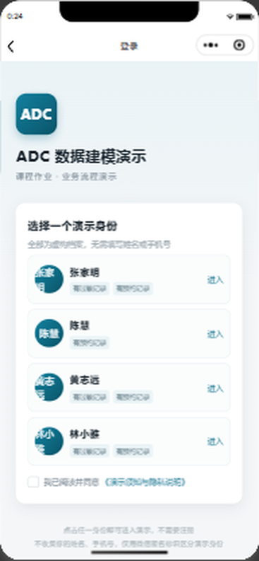
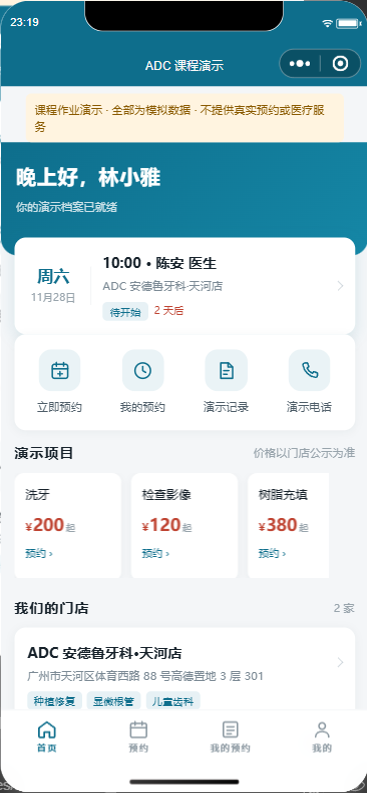
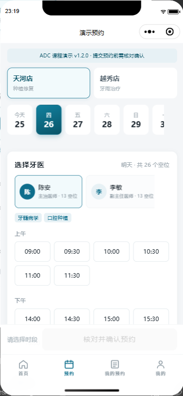
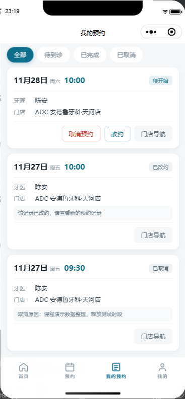
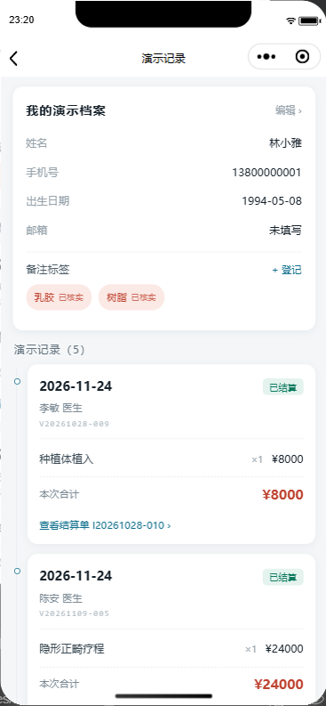
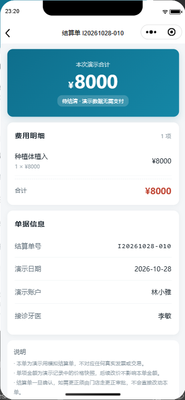
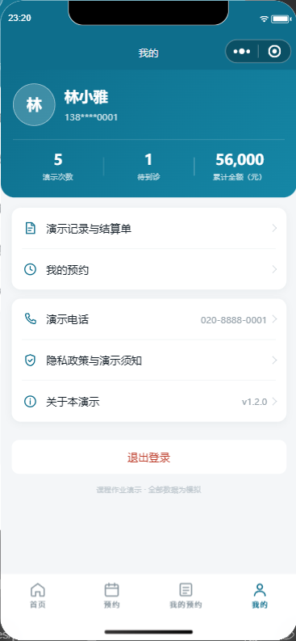

# 安德鲁牙科连锁管理系统 · 课程作业

陈德文　1602240125　2026 年 11 月

## 先看这两个

**小程序**（微信扫码打开）

  

**网页版**（和小程序共用同一份数据）

https://patient-damselfly-d3di6275acf229-1540280749.tcloudbaseapp.com/

进去点一个身份就行，不用输账号密码。

手机上不方便输地址的话，扫这张也行：

系统分两端：一个给患者用的小程序，一个给员工用的网页后台。两端连的是同一个云数据库，所以在网页里给某个预约登记到诊，小程序「我的预约」里马上就能看到。

小程序进去不用注册，从四个虚构身份里挑一个就行：林小雅、张家明、陈慧、黄志远。网页版有 8 个员工身份（前台 2 人、牙医 3 人、财务、运营、总部经理），点一个进去，13 个视图按角色分权限，预约、到诊、诊间录入、开单、结算、排班、季度核算这些流程是通的。

## 界面

  
  
  
  

  
  
  

上面七张是小程序截图，依次为：选演示身份、首页、预约（按时段挑牙医）、我的预约（待开始 / 已改约 / 已取消）、就诊记录、结算单、我的。页面里的姓名、手机号、金额都是虚构种子数据，手机号在界面上做了掩码。

员工端网页的 13 个视图没有逐张截，直接点上面那个云端地址看更直观。

## 作业说明

这份作业依据 Ivey 案例 W44694《Andrew's Dental Chain》和《ADC 拟开发项目与业务需求说明》完成。主要内容是连锁牙科诊所的业务分析与数据建模，另外按建好的模型做了一个能跑起来的演示系统，用来检验模型能不能支撑文档里写的那些业务。

根目录的 `陈德文1602240125 ADC拟开发项目与业务需求说明.docx` 是原始需求文档，里面有业务用例图、序列图和 UC01–UC12 的用例规约。下面的模型设计和实现都以它为准。

有一点要先说明：原需求第 4 章写的是「患者通过电话和柜台与员工沟通，没有患者自助登录端」，业务办理以内部岗位为主。我做演示系统时，把患者查看自己的预约、就诊记录和结算单这一块单独做成了一个微信小程序，算是对原需求的一点延伸；预约、到诊、治疗确认、结算开单、成本录入、季度核算这些主体业务，仍然按文档里的岗位分工放在员工端实现。

## 目录

| 位置 | 内容 |
|---|---|
| `01-需求分析与业务建模/` | 需求摘要、岗位与场景、用例和业务规则 |
| `02-数据模型/` | 16 个集合的字段设计与拆分理由，本次作业的重点 |
| `03-系统实现/` | 两端程序与云函数的实现说明、运行和访问方式 |
| `04-测试与演示截图/` | 功能验证记录、界面截图、小程序码与网页二维码 |
| `05-课程设计小结.md` | 做这份作业的过程和体会 |
| `源码/adc-demo/` | 完整工程代码 |
| 根目录 docx | 原始需求文档，原样保留 |

## 数据模型

按「一个集合对应一个生命周期一致的业务对象」来划分，核心业务集合 11 个：

`clinics`、`qualifications`、`dentists`、`patients`、`appointments`、`visits`、`treatments`、`visit_treatments`、`invoices`、`costs`、`wechat_users`。

做员工端时又补了 5 张支撑表：`staff`（员工账号）、`staff_sessions`（登录会话）、`schedules`（出诊排班）、`audit_logs`（操作留痕）、`quarter_closes`（季度核算版本），所以实际落库 16 个。

有几处是反复考虑过的：

- 预约 `appointments` 是计划，就诊 `visits` 是事实，必须分开。取消的预约不产生就诊，混在一张表里就没法算取消率。
- 牙医不设「所属门店」，用 `clinic_ids` 记出诊门店。案例里牙医和患者都跨店流动，挂一个固定门店就表达不了了。
- 过敏按条目存在患者文档里并带确认状态，不能用一段文本覆盖，也要能区分「还没问过」和「问过、没有已知过敏」。
- 结算单行并入结算单的 `lines` 数组，但每行保留 `line_id` 指回治疗明细，保证金额能追溯。
- 资质单独做目录集合，牙医通过 `qualification_ids` 关联，一人多证、一证多人。

完整字段、关系图和状态机见 `02-数据模型/数据模型.md`，为什么这样拆见同目录的 `模型设计说明.md`。

## 系统实现

- 患者端：微信小程序，12 个页面，可以看预约、就诊记录和结算单，也能自助预约、取消和改约。
- 员工端：一个网页工作台，按前台、牙医、财务、运营、总部经理 5 个角色分权限，共 13 个视图（业务办理 9 个，另有出诊排班、操作记录、核算审批、员工账号）。
- 后端：CloudBase 云函数 `api` 作为唯一入口。两端调同一个函数、读写同一套集合，所以在网页里登记到诊，小程序那边马上能看到，不存在两边数据对不上的问题。

细节见 `03-系统实现/`，运行方法见该目录下的 `运行与访问.md`。

## 运行

只想看效果不用装任何东西，扫上面的小程序码，或者点网页链接。

要在本地跑：小程序用微信开发者工具导入 `源码/adc-demo/`；员工端网页在 `源码/adc-demo/` 下执行 `node web/serve.js`，浏览器打开终端给的地址。本地起的网页连的还是线上云环境，和小程序同一份数据。

演示数据全部是模拟的，门店、牙医、患者、价格和结算单都不是真实资料。
